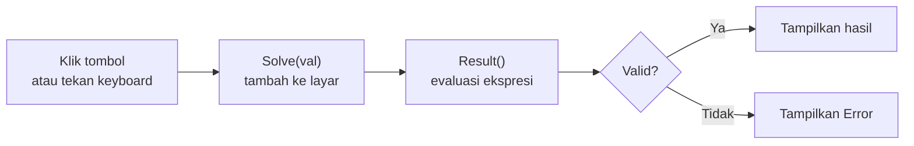

<div align="center">


[](#demo)


<a href="#demo"></a> <a href="#demo">Demo</a> &nbsp;&middot;&nbsp;
<a href="#fitur"></a> <a href="#fitur">Fitur</a> &nbsp;&middot;&nbsp;
<a href="#kontrol-keyboard"></a> <a href="#kontrol-keyboard">Keyboard</a> &nbsp;&middot;&nbsp;
<a href="#cara-kerja"></a> <a href="#cara-kerja">Cara Kerja</a> &nbsp;&middot;&nbsp;
<a href="#menjalankan"></a> <a href="#menjalankan">Menjalankan</a>

</div>

---

## Ringkasan

Tugas Calculator adalah kalkulator berbasis web yang dibangun murni dengan HTML, CSS, dan JavaScript. Tidak ada framework, library, maupun proses build: cukup buka `index.html` di browser dan kalkulator langsung bisa dipakai.

Kalkulator dapat dioperasikan dengan klik pada tombol maupun lewat keyboard, dan menampilkan pesan `Error` ketika ekspresi yang dimasukkan tidak valid.

---

## Demo

<div align="center">


<br>

<sub>Contoh perhitungan <code>12 x 4 + 8</code> dengan hasil <code>56</code></sub>

</div>

---

## Fitur

| Fitur | Keterangan |
|---|---|
|  &nbsp;**Operasi dasar** | Penjumlahan, pengurangan, perkalian, dan pembagian |
|  &nbsp;**Modulo** | Operator `%` untuk sisa bagi |
|  &nbsp;**Bilangan desimal dan `00`** | Tombol titik dan tombol `00` untuk input angka lebih cepat |
|  &nbsp;**Hapus cepat** | `C` mengosongkan layar, `⌫` menghapus satu karakter terakhir |
|  &nbsp;**Dukungan keyboard** | Semua operasi utama bisa dilakukan tanpa mouse |
|  &nbsp;**Penanganan error** | Ekspresi tidak valid menampilkan `Error`, bukan merusak tampilan |
|  &nbsp;**Tanpa dependensi** | Tiga berkas saja, langsung jalan di browser mana pun |

---

## Kontrol Keyboard

| Tombol | Aksi |
|---|---|
| `0` - `9` | Memasukkan angka |
| `+` `-` `*` `/` | Operator tambah, kurang, kali, bagi |
| `x` | Operator kali (ditampilkan sebagai `x`) |
| `.` | Titik desimal |
| `%` | Modulo |
| `Enter` | Menghitung hasil |
| `Backspace` | Menghapus satu karakter terakhir |
| `C` | Mengosongkan layar |

---

## Cara Kerja



| Fungsi | Peran |
|---|---|
| `Solve(val)` | Menambahkan angka atau operator ke layar |
| `Result()` | Mengevaluasi ekspresi di layar dan menampilkan hasilnya, atau `Error` jika gagal |
| `Clear()` | Mengosongkan layar |
| `Back()` | Menghapus satu karakter terakhir |
| Event `keydown` | Menghubungkan input keyboard ke fungsi-fungsi di atas |

---

## Teknologi

| Bagian | Teknologi | Keterangan |
|---|---|---|
| Struktur | HTML5 | Layar dan tombol kalkulator berbasis `<input>` dalam satu form |
| Tampilan | CSS3 | Flexbox untuk pemusatan dan tata letak layar |
| Logika | JavaScript | Manipulasi DOM dan penanganan event |

---

## Struktur

```
.
├── docs/
│   ├── demo.gif
│   └── preview.png
└── tugas membuat kalkulator/
    ├── index.html     Struktur dan tombol kalkulator
    ├── style.css      Tampilan
    └── index.js       Logika dan input keyboard
```

---

## Menjalankan

Tidak perlu instalasi. Clone repository, lalu buka `index.html` di browser.

```bash
git clone https://github.com/HaryMuktiRamdhani/Tugas-Calculator.git
cd Tugas-Calculator/"tugas membuat kalkulator"
```

Setelah itu buka berkas `index.html` dengan klik dua kali, atau jalankan server lokal:

```bash
python -m http.server 8000
```

Lalu buka `http://localhost:8000`.

---

## Catatan Teknis

- Ekspresi dievaluasi dengan `eval()`. Ini praktis untuk proyek latihan dan penggunaan lokal, tetapi untuk aplikasi produksi sebaiknya diganti dengan parser ekspresi.
- Operator `%` bekerja sebagai **modulo** (sisa bagi) seperti di JavaScript, bukan persentase. Contoh: `10 % 3` menghasilkan `1`.

---

<div align="center">

Dibuat oleh **Hary Mukti Ramdhani** &nbsp;&middot;&nbsp; [@HaryMuktiRamdhani](https://github.com/HaryMuktiRamdhani)


</div>
