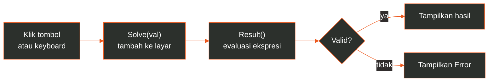

# Tugas Calculator

Kalkulator web yang dibangun dengan HTML, CSS, dan JavaScript murni. Tanpa framework, tanpa proses build, tanpa dependensi: buka `index.html` dan langsung dipakai.


**[Demo](#demo)** &nbsp;/&nbsp; **[Simulasi](#simulasi-interaktif)** &nbsp;/&nbsp; **[Fitur](#fitur)** &nbsp;/&nbsp; **[Keyboard](#kontrol-keyboard)** &nbsp;/&nbsp; **[Cara Kerja](#cara-kerja)** &nbsp;/&nbsp; **[Struktur](#struktur)** &nbsp;/&nbsp; **[Menjalankan](#menjalankan)**

## Demo

<p align="center">
  
</p>

<p align="center">
  <sub>Tampilan kalkulator setelah menghitung <code>12 x 4 + 8</code></sub>
</p>

## Simulasi Interaktif

Animasi di bawah menjalankan kalkulator secara otomatis dan berulang. Tombol yang ditekan diberi lingkaran oranye, dan layar berubah mengikuti setiap langkah.

<p align="center">
  
</p>

<p align="center">
  <sub>Urutan simulasi: <code>12 x 4 + 8</code> &rarr; <code>9 ÷ 4</code> &rarr; <code>500 ⌫ + 25</code> &rarr; <code>5 +</code> (menampilkan <code>Error</code>)</sub>
</p>

## Fitur

<table>
  <tr>
    <td width="33%" valign="top">
      <br>
      <b>Operasi dasar</b><br>
      Tambah, kurang, kali, dan bagi
    </td>
    <td width="33%" valign="top">
      <br>
      <b>Modulo</b><br>
      Operator <code>%</code> untuk sisa bagi
    </td>
    <td width="33%" valign="top">
      <br>
      <b>Desimal dan 00</b><br>
      Tombol titik dan <code>00</code> untuk input lebih cepat
    </td>
  </tr>
  <tr>
    <td width="33%" valign="top">
      <br>
      <b>Hapus cepat</b><br>
      <code>C</code> mengosongkan layar, <code>⌫</code> menghapus satu karakter
    </td>
    <td width="33%" valign="top">
      <br>
      <b>Dukungan keyboard</b><br>
      Semua operasi utama tanpa mouse
    </td>
    <td width="33%" valign="top">
      <br>
      <b>Penanganan error</b><br>
      Ekspresi tidak valid menampilkan <code>Error</code>
    </td>
  </tr>
</table>

## Kontrol Keyboard

| Tombol | Aksi |
|---|---|
| <kbd>0</kbd> – <kbd>9</kbd> | Memasukkan angka |
| <kbd>+</kbd> <kbd>-</kbd> <kbd>*</kbd> <kbd>/</kbd> | Tambah, kurang, kali, bagi |
| <kbd>x</kbd> | Kali (ditampilkan sebagai `x`) |
| <kbd>.</kbd> | Titik desimal |
| <kbd>%</kbd> | Modulo |
| <kbd>Enter</kbd> | Menghitung hasil |
| <kbd>Backspace</kbd> | Menghapus satu karakter terakhir |
| <kbd>C</kbd> | Mengosongkan layar |

## Cara Kerja



| Fungsi | Peran |
|---|---|
| `Solve(val)` | Menambahkan angka atau operator ke layar |
| `Result()` | Mengevaluasi ekspresi di layar, menampilkan hasil atau `Error` |
| `Clear()` | Mengosongkan layar |
| `Back()` | Menghapus satu karakter terakhir |
| Event `keydown` | Menghubungkan input keyboard ke fungsi di atas |

| Bagian | Teknologi |
|---|---|
| Struktur | HTML5: layar dan tombol berbasis `<input>` dalam satu form |
| Tampilan | CSS3: Flexbox untuk pemusatan dan tata letak layar |
| Logika | JavaScript: manipulasi DOM dan penanganan event |

## Struktur

```
.
├── docs/
│   ├── screenshot.png
│   └── simulasi.svg
└── tugas membuat kalkulator/
    ├── index.html     Struktur dan tombol kalkulator
    ├── style.css      Tampilan
    └── index.js       Logika dan input keyboard
```

## Menjalankan

Tidak perlu instalasi. Clone repository, lalu buka `index.html` di browser.

```bash
git clone https://github.com/HaryMuktiRamdhani/Tugas-Calculator.git
cd Tugas-Calculator/"tugas membuat kalkulator"
```

Buka `index.html` dengan klik dua kali, atau jalankan server lokal:

```bash
python -m http.server 8000
```

Lalu buka `http://localhost:8000`.

## Catatan Teknis

> [!NOTE]
> Operator `%` bekerja sebagai **modulo** (sisa bagi) seperti di JavaScript, bukan persentase. Contoh: `10 % 3` menghasilkan `1`.

> [!WARNING]
> Ekspresi dievaluasi dengan `eval()`. Ini praktis untuk proyek latihan dan penggunaan lokal, tetapi untuk aplikasi produksi sebaiknya diganti dengan parser ekspresi.

---

Dibuat oleh **Hary Mukti Ramdhani** &nbsp;/&nbsp; [@HaryMuktiRamdhani](https://github.com/HaryMuktiRamdhani)
